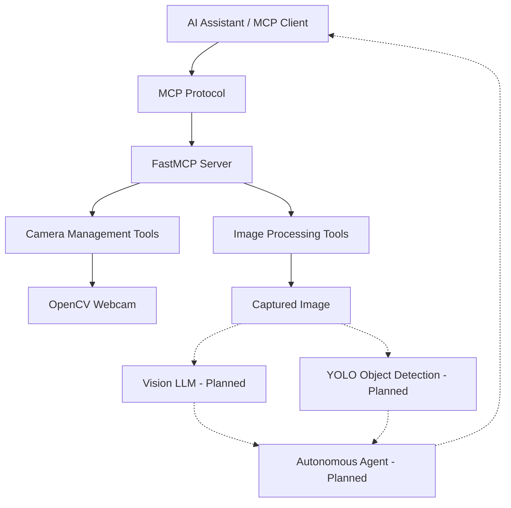

# MCP Vision Agent 👁️

**An MCP-based webcam interaction server that enables AI assistants to capture, process, and interact with visual data through natural-language-driven tool orchestration.**

[](https://www.python.org/)
[](https://opencv.org/)
[](https://modelcontextprotocol.io/)
[](https://github.com/jlowin/fastmcp)

---

## 🚀 Overview

MCP Vision Agent is a Python-based Model Context Protocol (MCP) server that bridges webcam hardware with AI assistants, enabling them to interact with camera devices through structured tools.

Built using **OpenCV and FastMCP**, the server exposes camera management and image-processing capabilities as MCP tools, allowing compatible AI clients to capture images, configure camera settings, and perform image transformations.

The project is designed to evolve into an autonomous visual agent by integrating vision-capable LLMs, object detection, and multi-step visual reasoning workflows.

## ✨ Features

### 1. Camera Management

Provides 7 MCP tools for webcam interaction and lifecycle management.

- Camera initialization and device connection.
- Still-image capture.
- Camera connection and disconnection management.
- Camera configuration and property adjustment.
- Connection status monitoring.
- Thread-safe camera resource management.

### 2. Image Processing

Provides 4 image-processing tools powered by OpenCV.

| Operation | Description |
|---|---|
| Grayscale Conversion | Converts captured images into grayscale. |
| Image Resizing | Changes image dimensions based on specified parameters. |
| Image Rotation | Rotates images according to the requested angle. |
| Region Cropping | Extracts custom regions of interest from images. |

Image outputs are JPEG-encoded for efficient transfer through MCP responses.

### 3. AI-Powered Visual Understanding (Planned)

Future extensions aim to introduce vision-language model integration, allowing AI assistants to understand captured camera frames.

Potential capabilities:

- Natural-language scene descriptions.
- Visual question answering.
- Object identification and contextual understanding.
- Image-based reasoning.

### 4. Computer Vision Integration (Planned)

Integration of dedicated computer vision capabilities through additional MCP tools.

- YOLO-based real-time object detection.
- Motion detection and activity monitoring.
- Object localization and identification.
- Visual change detection between consecutive frames.

### 5. Autonomous Visual Workflows (Planned)

The long-term goal is to enable multi-step autonomous visual interaction.

**Example workflow:**

1. Monitor the webcam for motion.
2. Detect movement in the camera feed.
3. Automatically capture the relevant frame.
4. Run object detection on the captured image.
5. Send the frame to a vision-capable LLM.
6. Generate a natural-language description of the observed changes.

This will enable users to interact with their physical environment through natural-language instructions.

---

## 🏗️ Architecture



## 🛠️ Tech Stack

| Technology | Purpose |
|---|---|
| Python | Core development |
| OpenCV | Camera access and image processing |
| MCP | Standardized communication between AI clients and tools |
| FastMCP | MCP server and tool implementation |
| NumPy | Image array manipulation |
| YOLO | Planned object detection |
| Vision LLMs | Planned visual understanding |

## 📂 Project Structure

```text
MCP-Vision-Agent/
│
├── server.py
├── requirements.txt
├── README.md
├── .gitignore
│
├── src/
│   ├── camera/
│   │   └── camera_manager.py
│   │
│   ├── image_processing/
│   │   └── image_tools.py
│   │
│   └── tools/
│       └── camera_tools.py
│
└── tests/
    └── test_camera.py
```

*The structure above illustrates the intended organization; adjust it to match the actual repository.*

## ⚙️ Installation and Setup

### Prerequisites

- Python 3.10+
- Webcam or compatible camera device.
- Git.
- An MCP-compatible client.

### 1. Clone the Repository

```bash
git clone https://github.com/Jaraws12/video-still-capture-mcp.git

cd video-still-capture-mcp
```

### 2. Create a Virtual Environment

```bash
python -m venv venv
```

Activate the environment:

**Windows**
```bash
venv\Scripts\activate
```

**Linux / macOS**
```bash
source venv/bin/activate
```

### 3. Install Dependencies

```bash
pip install -r requirements.txt
```

### 4. Run the MCP Server

```bash
python server.py
```

Use the actual server entry-point filename if it differs from `server.py`.

## 🔌 MCP Client Integration

The server can be connected to an MCP-compatible AI client.

Example configuration for a local MCP client:

```json
{
  "mcpServers": {
    "vision-agent": {
      "command": "python",
      "args": [
        "ABSOLUTE_PATH_TO_PROJECT/server.py"
      ]
    }
  }
}
```

Replace the path with the actual location of the server entry point on your machine.

Once connected, the AI assistant can discover and invoke the camera and image-processing tools through MCP.

## 💡 Example Use Cases

The following examples illustrate the intended interaction model.

**Camera Interaction**
> Capture an image from my webcam.

**Image Processing**
> Convert the captured image to grayscale and resize it to 640x480.

**Visual Question Answering (Planned)**
> What objects are visible on my desk?

**Autonomous Monitoring (Planned)**
> Watch for movement, capture an image when something changes, and describe what happened.

## 🗺️ Roadmap

- [x] MCP server implementation using FastMCP.
- [x] Camera initialization and lifecycle management.
- [x] Still-image capture using OpenCV.
- [x] Camera configuration and monitoring tools.
- [x] Image-processing operations.
- [x] JPEG-encoded image responses.
- [ ] Vision-LLM integration for scene understanding.
- [ ] YOLO-based object detection.
- [ ] Motion detection and activity monitoring.
- [ ] Autonomous multi-step visual workflows.
- [ ] Automated test coverage for camera and image-processing tools.
- [ ] Capture-to-response latency benchmarking.
- [ ] Demo GIF/video showcasing end-to-end visual interaction.

## 🔬 Testing and Performance

Automated testing and performance benchmarking are planned extensions.

The testing strategy will cover:

- Camera initialization and connection failures.
- Image capture and encoding.
- Image transformation correctness.
- Camera resource cleanup.
- MCP tool execution and error handling.
- End-to-end capture-to-response latency.

Performance will be evaluated using capture-to-response latency under different camera resolutions and image-processing workloads.

## 🎯 Project Vision

The ultimate objective is to transform a traditional webcam interface into an intelligent visual interaction system.

By combining MCP tool orchestration, computer vision, and vision-language models, MCP Vision Agent aims to give AI assistants the ability to observe their surroundings, interpret visual information, and execute context-aware actions.

## 👨‍💻 Author

**Swaraj Kumar Sahoo**

Integrated MSc Mathematics | NIT Rourkela

- GitHub: [@Jaraws12](https://github.com/Jaraws12)
- Project Repository: [MCP Vision Agent](https://github.com/Jaraws12/video-still-capture-mcp)

---

*Built with Python, OpenCV, and MCP.*
